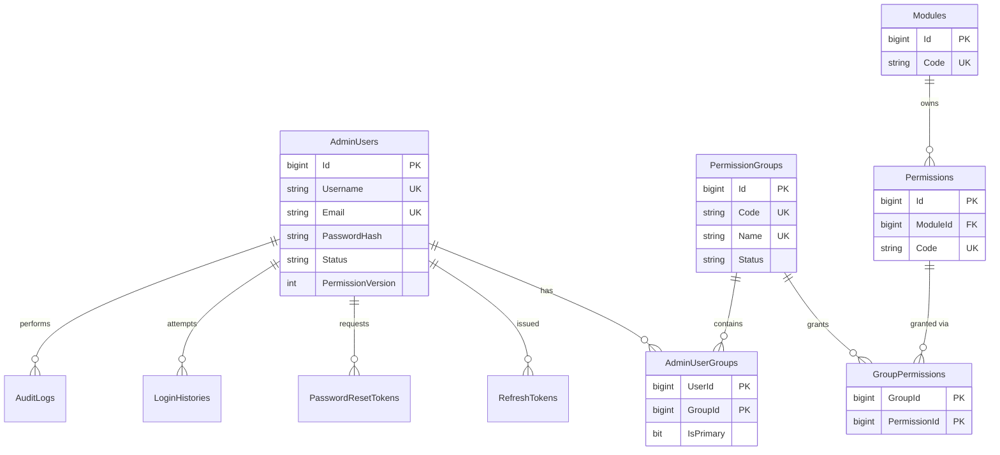

# Sage Admin Panel — Sprint 0 Analysis

Status: ANALYSIS ONLY. No code written. No reference project modified.
Everything under "Actual" below was read from disk. Everything under "Recommended" is a proposal awaiting approval.

---

## 0. Findings that need your decision (read first)

| # | Finding | Why it matters | Recommendation |
|---|---------|----------------|----------------|
| D1 | ixcheck backend targets **net5.0**, uses **MySQL** (`MySql.Data`), plus VistaDB and Redis. Sage needs .NET 10 + SQL Server. | The "same pattern" cannot be copied 1:1. | Keep layout, naming, DI style, response envelope, and the "database functions" wrapper idea. Replace the engine with `Microsoft.Data.SqlClient`, truly async, **parameterized** queries. |
| D2 | ixcheck builds SQL by **string concatenation** plus a `Sanitization.Sanitize()` helper. | SQL-injection risk. Do not reproduce. | All Sage SQL parameterized (ADO.NET `SqlCommand` + stored procedures where listed). |
| D3 | In `DashbordController` the permission check is followed by `_functionReturn.Status = true;`, which **overrides the result and allows every request**. Failures also return 401 instead of 403. | Never copy this. Your spec requires real 401/403. | Use an `IAuthorizationHandler` + `[HasPermission("Employee.View")]` policy. 403 for missing permission, 401 for bad token. |
| D4 | `appsettings.json` in the reference contains **live-looking DB and Redis passwords, a JWT signing key, and Minio keys committed to git** (including a duplicate commented-out block). I saw them while inspecting. I have not repeated them here. | Security exposure outside this project. | Tell the ixcheck owners to rotate them. Sage uses User Secrets (dev) and environment variables / secret store (Staging/Prod). Nothing hardcoded. |
| D5 | The reference's only test project is a **placeholder** (`UnitTest1` with an empty `[Fact]`, `netcoreapp3.1`, xUnit 2.4.0). | There is no real test convention to mirror beyond "xUnit". | Use xUnit (compatible), modern versions. Test stack is in section 13. |
| D6 | Reference password hashing is PBKDF2-HMAC-SHA256, **10,000 iterations**. JWT lifetime is 1200 min. CORS is `AllowAnyOrigin`. | Weak by today's norms. | Sage: PBKDF2-SHA256 at 600k iterations (same hash format, versioned), 15-min access token, explicit CORS origins. |
| D7 | Your folders are **`bakend`** (typo) in both `sage-admin` and `sage-user`. `sage-common-lib` is empty. A sibling **`D:\Project\Sage\sage-user`** (empty `bakend`, `frontend`) already exists. | Spec requires `backend`. The sibling suggests the User Panel is a separate repo that will consume the common lib. | Rename `bakend` → `backend` in `sage-admin` (needs your OK). Ask below about common-lib sharing. |
| D8 | ixcheck consumes its common lib as a **pre-built DLL** copied into `src/CommonLib/`, not a project/NuGet reference. | Painful versioning. | Recommend `ProjectReference` now, and a private NuGet feed later when `sage-user` starts. |
| D9 | Reference defines an `I<Name>` interface for **every model** (139 files in `Models/Interfaces`). | Very heavy and low value. | Keep interfaces for services and settings. Plain DTO/model classes for data. Your call. |
| D10 | Reference permission strings look like `centreplan:dashbord:exams:view`. Your spec uses `Employee.View`. | Different format. | Use your `Module.Action` format. Codes are stored in SQL, not constants. |

### Questions for you
1. **Rename `bakend` → `backend`** and **use a `.sln` at `backend/`**: OK?
2. **Common lib sharing:** `ProjectReference` from `sage-admin/backend` now (and later `sage-user` references the same path or a NuGet feed)?
3. **Test database:** is Docker available for Testcontainers SQL Server, or should integration tests use a dedicated local SQL Server instance (`sqlcmd` 16.0 exists on this machine; I have not checked for a running server)? Please also provide dev/staging server names (no passwords in chat — I'll use User Secrets).
4. **Redis:** ixcheck uses Redis for permission/session cache. Sage plan avoids Redis (in-memory + DB version stamp). OK, or do you want Redis from day one?
5. **Per-model interfaces (D9):** skip them?
6. **Super Admin bootstrap:** seed one Super Admin whose initial password is supplied by environment variable at deploy time (never in a script). OK?

Toolchain found: .NET SDK 10.0.402 (also 3.1, 8.0, 9.0), Node 20.19.0, `sqlcmd` 16.0.

---

## 1. Actual ixcheck backend structure (`ixcheck-centre-planning-api`)

```
ixcheck-centre-planning-api/
  centre-planning-api.sln
  .gitlab-ci.yml, Dockerfile.{dev,qat,demo,prod}, README.md (2 lines)
  src/
    centre-planning-api.csproj      (net5.0, RootNamespace CentrePlanningApi)
    Program.cs                      (WebHost + Kestrel, --port=NNNNN arg, default 10011)
    Startup.cs                      (ConfigureServices / Configure; JWT, CORS, Swagger, Serilog, DI)
    appsettings.json, __appsettings*.json
    Controllers/        22 files    <Name>Controller.cs
    AppFunctions/       24 services <Name>Functions.cs
      Interfaces/       I<Name>Functions.cs
    AppValidations/     ApplicationCommonFunctions, ApplicationValidationFunctions
    Globals/            ApplicationConstants, ApplicationDatabaseConstants,
                        ApplicationEnumeration, ApplicationJsonReturnConstants, PermissionConstants
    Models/             108 files; Models/Filter (18), Models/HttpPost (20), Models/Interfaces (139)
    CommonLib/          pre-built DLLs (ixcheck-common-lib.dll, etc.)
    Reports/, WkHtml/, Packages/, db/, Properties/
```

Conventions observed:
- Namespace root `CentrePlanningApi.*`; controllers `[Authorize]`, `[ApiController]`, route `"api/" + Constants.Api.Version + "/[controller]"` (version constant `"V1"`).
- Private fields `_camelCase`; **constructor params prefixed with `__`**; locals `_camelCase`.
- Controller → `I<X>Functions` (service) → `IDatabaseFunctions` (common lib). Controllers hold no SQL.
- Every method returns a tuple `(string jsonReturn, IFunctionReturn functionReturn)`; async methods are `Task.Run` wrappers over synchronous ones (not truly async).
- Method name tags for logs: `"C:Dashbord:GetTotalExams"`, `"F:Dashbord:GetTotalExams"`.
- Region blocks (`#region Local Variables`), XML doc comments on every member.
- DI: everything `AddScoped`, settings via `IOptionsSnapshot<T>` mapped to interface.
- Pipeline: Swagger (Development only), HSTS, CORS, JWT bearer, NWebsec security headers (CSP, XFO, XSS, referrer policy).
- Logging: Serilog rolling file, config from `Serilog` section.
- Config: `appsettings.json` loaded with `AddEnvironmentVariables()`. No per-environment `appsettings.{Env}.json` is actually used (`__appsettings.Development.json` is a disabled copy).

## 2. Actual common library structure (`ixcheck-common-lib`)

`src/ixcheck-common-lib.csproj`: net5.0, RootNamespace `IXCheckCommonLib`. Packages: `Microsoft.AspNetCore.Cryptography.KeyDerivation` 5.0.2, `Microsoft.Extensions.Http` 5.0.0, `Microsoft.IdentityModel.Tokens` 6.8.0, `MySql.Data` 8.0.28, `Serilog.AspNetCore` 3.4.0, `Serilog.Settings.Configuration` 3.1.0, `Serilog.Sinks.Console/File`, `StackExchange.Redis` 2.2.4, `System.IdentityModel.Tokens.Jwt` 6.8.0, `VistaDB.6`, `Minio.NetCore`.

```
src/
  AppFunctions/   DatabaseFunctions (2327 lines, MySQL), DatabaseFunctionsCustomDb, DatabaseFunctionsVistaDb,
                  CacheFunctions (1198; permission/role checks via Redis), RedisService, LoggerFunctions,
                  EmailFunctions, HttpClientFunction(s), HttpFactoryClientFunctions, MinioFunctions,
                  ConnectionsMapping  (+ Interfaces/ for each)
  AppValidations/ CommonFunctions (error/ok helpers, Exception401Message etc.), Sanitization,
                  StringExtensions, ValidationFunctions
  Globals/        Constants, DatabaseConstants, Enumeration, JsonReturnConstants
  Models/         ApiResponse (+ ApiSuccessResponse/token response shapes), FunctionReturn, AppSettings,
                  ApiSettings, DatabaseSettings, LoggerSettings, EmailSettings/Params, JwtIssuerOptions,
                  TokenInfo, AuditLog, ActivityLog, Stats, UserLogin, UserPermission, AccessGroups,
                  CoreUserInfo, CustomerUserInfo, Paging/{Pagination,PaginationParams,HttpPaging}, ...
                  (+ Models/Interfaces)
  Security/       SecurityHash (PBKDF2 HMAC-SHA256, 128-bit salt, 256-bit key, versioned format)
```

Reusable concepts for Sage: `FunctionReturn`, `ApiResponse` (Error/Success/Token), `Paging`, `LoggerFunctions`, `CommonFunctions`, `ValidationFunctions`, `StringExtensions`, `SecurityHash`, `JwtIssuerOptions`, `DatabaseSettings` shape, `AuditLog`, `EmailFunctions`.
Not copied (ixcheck business/infra): ShiftDatabase*, CoreDatabase*, VistaDb, CustomDb, Minio, Redis, CustomerUserInfo, UserDesktop*, AccessGroups (ixcheck-specific), ConnectionsMapping.

## 3. Existing database connection implementation
- One connection string `DatabaseSettings:MySqlConnection` (plus `MySqlTimeout`, default 30 s; `RedisConnection`) bound via `IOptionsSnapshot<DatabaseSettings>` → `IDatabaseSettings`.
- The connection is created **inside each method** of `DatabaseFunctions` (`using (new MySqlConnection(...))`, `CommandTimeout` from settings). No pooling config, retry, or health check. Credentials are in `appsettings.json` (see D4).

## 4. Existing database access implementation
- `IDatabaseFunctions` (common lib) exposes `ExecuteInsert`, `ExecuteUpdate`, `ExecuteDelete`, `ExecuteScalar`, `ExecuteSelectDataTable/DataSet`, `ExecuteSelectJSON`, `ExecuteSelectJSONPaging`, and `ExecuteCheckExistsAnd{Insert,Update,Delete}[WithTran]`.
- Input is a raw SQL string (`ReadOnlySpan<char>`), a method-name tag for logs, and (for JSON reads) a dictionary mapping column → JSON property. Results are `(IFunctionReturn, ...)` tuples; selects return a **JSON string** built in the data layer.
- Transactions only in `...WithTran` variants. SQL exceptions are caught and mapped into `FunctionReturn`. Everything is synchronous.
- Permissions: `ICacheFunctions.CheckRoleAndPermissionInCacheAsync(permission, claims)` reads claims (`AID`, `UUID`, `jti`), checks application allow-list, and looks permissions up in Redis.

## 5. Existing testing framework
xUnit 2.4.0 + Microsoft.NET.Test.Sdk 16.2.0 + coverlet.collector, `netcoreapp3.1`, in `test/` beside `src/`. Contents: a single empty test. Present in `ixcheck-centre-log-api` and `ixcheck-reg-api` (not in centre-planning-api). No mocking library, no integration tests.

---

## 6. Recommended `sage-common-lib` structure
Target `net10.0`, `RootNamespace SageCommonLib`. Mirrors ixcheck folder names; no Admin business logic.

```
sage-common-lib/
  SageCommonLib.sln
  src/
    SageCommonLib.csproj
    AppFunctions/      LoggerFunctions, EmailFunctions, HttpClientFunctions   (+ Interfaces/)
    AppValidations/    CommonFunctions, ValidationFunctions, Sanitization (HTML/log only), StringExtensions
    Database/          SqlConnectionFactory, DatabaseFunctions (async, parameterized)  (+ Interfaces/)
    Globals/           Constants, Enumeration, JsonReturnConstants
    Models/            ApiResponse, FunctionReturn, PagedResult/PaginationParams, JwtIssuerOptions,
                       DatabaseSettings, LoggerSettings, EmailSettings, TokenInfo   (+ Interfaces/ for settings only)
    Security/          PasswordHasher (PBKDF2), TokenGenerator (secure random), JwtTokenService (generic),
                       PermissionRequirement/Handler base abstractions (no admin tables)
    Exceptions/        AppException, ValidationException, NotFoundException, ForbiddenException, ConflictException
  Tests/ (SageCommonLib.Tests)   <- see note below
```
Note: you said exactly three top-level folders; common-lib tests would live in `sage-common-lib/Tests`. Confirm, or I put them under `backend/Tests/CommonLib.Tests`.

Dependency direction: `backend → sage-common-lib`; common lib references nothing of Sage Admin.

## 7. Recommended Sage backend structure
Follows ixcheck folder naming. Project `SageAdminApi`, root namespace `SageAdminApi`.

```
backend/
  SageAdmin.sln
  src/
    SageAdminApi.csproj            (net10.0)
    Program.cs, Startup.cs (or minimal-host Program with Startup-style extension methods)
    appsettings.json, appsettings.Development/Staging/Production.json (no secrets)
    Controllers/       AuthController, AdminUsersController, GroupsController, PermissionsController,
                       DashboardController, AuditLogsController, SettingsController, StatusController
    AppFunctions/      AuthFunctions, AdminUserFunctions, GroupFunctions, PermissionFunctions, ModuleFunctions,
                       DashboardFunctions, AuditFunctions, SettingsFunctions, PermissionCacheFunctions
      Interfaces/
    Data/              (DB access, no controller access)
      Repositories/    AdminUserRepository, GroupRepository, PermissionRepository, RefreshTokenRepository, ...
      Interfaces/
    Authorization/     HasPermissionAttribute, PermissionPolicyProvider, PermissionHandler
    Middleware/        ExceptionHandlingMiddleware, SecurityHeadersMiddleware, RequestLoggingMiddleware
    AppValidations/    FluentValidation validators per request DTO
    Globals/           ApplicationConstants, ApplicationEnumeration, ApplicationJsonReturnConstants
    Models/            Entities (row models), Dto/{Request,Response}, Filter/
  database/
    DDL/ StoredProcedures/ Views/ Functions/ SeedData/ Scripts/   (Scripts = deploy runner + Tests-only helpers)
  Tests/
    UnitTests/        Authentication/ AdminUsers/ Groups/ Permissions/ Authorization/ Database/
    IntegrationTests/ Authentication/ AdminUsers/ Groups/ Permissions/ Security/ Database/
```
Deviation from ixcheck (justified): add `Data/Repositories` + `Authorization` + `Middleware`. ixcheck puts SQL inside `AppFunctions`; you asked for access logic separate and no queries in controllers. Layering is Controller → AppFunctions (rules) → Repository (SQL) → `IDatabaseFunctions`/connection factory. Say so if you prefer ixcheck's exact two-layer shape.

Response envelope: keep ixcheck's `ApiResponse` shape (`httpStatus`, `type`, `messageType`, `message[]`, `data`), plus a paged variant. Route: `api/admin/...` as you specified (not `api/V1/[controller]`), since your endpoint list is explicit. Versioning via header later.

## 8. Recommended Next.js frontend structure
```
frontend/
  package.json, next.config.ts, tsconfig.json, tailwind (v4 CSS-first or v3 config), eslint, .env.example
  src/
    app/
      (auth)/login, forgot-password, reset-password
      (admin)/layout.tsx            <- auth guard + sidebar shell
        dashboard/ users/ groups/ permissions/ audit-logs/ profile/ settings/
        users/[id]/, groups/[id]/ (+ new)
      forbidden/ not-found.tsx, error.tsx
    components/   ui/ (Button, Input, Modal, Table, Pagination, Badge, Toast), layout/ (Sidebar, Topbar), forms/, guards/ (Can, RequirePermission)
    features/     auth/ users/ groups/ permissions/ audit/ dashboard/ settings/  (each: components, hooks, schemas)
    services/     apiClient.ts (fetch wrapper, refresh-on-401, envelope unwrap), authService, userService, ...
    hooks/        usePermission, useDebounce, usePagedQuery
    contexts/     AuthContext (user + permissions), ToastContext
    types/        api.ts, auth.ts, user.ts, group.ts, permission.ts
    utils/        format, permission helpers
    styles/       globals.css
  middleware.ts   (redirect unauthenticated to /login)
```
Sidebar items come from `/api/admin/auth/me` (modules + permissions from SQL). No permission lists in components. Token storage: access token in memory, refresh token in `HttpOnly; Secure; SameSite` cookie set by the backend (no tokens in localStorage). To be confirmed in Sprint 2 because it needs a same-site proxy (Next.js rewrites) or matching domains.

## 9. SQL Server database schema (proposed)

Conventions: PascalCase plural tables, `Id BIGINT IDENTITY` PK, `PublicId UNIQUEIDENTIFIER` for API exposure (ixcheck also exposes GUIDs), `CreatedAtUtc/UpdatedAtUtc DATETIME2(3)`, `CreatedBy/UpdatedBy`, `RowVersion` where concurrent edits matter, named constraints (`PK_`, `FK_`, `UQ_`, `IX_`, `DF_`, `CK_`).

| Table | Key columns / constraints |
|-------|---------------------------|
| `SchemaVersions` | ScriptName (UQ), Checksum, AppliedAtUtc, AppliedBy — tracks which numbered scripts ran |
| `AdminUsers` | FirstName, LastName, Username (UQ, filtered unique on non-deleted), Email (UQ), MobileNumber, PasswordHash, PasswordUpdatedAtUtc, MustChangePassword, IsSuperAdmin, Status (CK: Active/Inactive/Locked), FailedLoginCount, LockoutEndUtc, PermissionVersion (INT, bumped when access changes), LastLoginAtUtc, IsDeleted |
| `Modules` | Code (UQ, e.g. `Employee`), Name, Category (e.g. HR), SortOrder, IsActive, IsSystem |
| `Permissions` | ModuleId FK, Code (UQ, e.g. `Employee.View`), Action (View/Add/Edit/Delete/Export/…), Name, Description, IsActive. UQ(ModuleId, Action) |
| `PermissionGroups` | Name (UQ), Code (UQ), Description, Status, IsSystem |
| `GroupPermissions` | GroupId FK, PermissionId FK, PK(GroupId, PermissionId), GrantedAtUtc/By |
| `AdminUserGroups` | UserId FK, GroupId FK, IsPrimary BIT, PK(UserId, GroupId); filtered unique index enforcing one primary per user — keeps DB extensible to multiple groups while UI sends one |
| `RefreshTokens` | UserId FK, TokenHash (SHA-256, never raw), FamilyId, ExpiresAtUtc, RevokedAtUtc, ReplacedByTokenId, CreatedByIp, UserAgent — rotation with reuse detection |
| `PasswordResetTokens` | UserId FK, TokenHash, ExpiresAtUtc, UsedAtUtc, RequestedIp |
| `LoginHistories` | UserId (nullable for unknown user), UsernameAttempted, IsSuccess, FailureReason, IpAddress, UserAgent, AttemptedAtUtc |
| `AuditLogs` | ActorUserId, Action, EntityType, EntityId, OldValues/NewValues (NVARCHAR(MAX), JSON with CK ISJSON), IpAddress, CreatedAtUtc; indexes on (CreatedAtUtc), (EntityType, EntityId), (ActorUserId) |
| `Settings` | Key (UQ), Value, ValueType, IsSecret, UpdatedAtUtc/By — for the Settings module |

Deletion rules: groups with any `AdminUserGroups` rows cannot be deleted (FK `NO ACTION` + service check + 409). Users are soft-deleted/deactivated, not hard-deleted, so audit history stays valid. Super Admin (`IsSuperAdmin`) bypasses permission lookup but is still audited.

## 10. DDL script organization
```
database/
  DDL/
    001_Create_SchemaVersions.sql
    002_Create_AdminUsers.sql
    003_Create_Modules.sql
    004_Create_Permissions.sql
    005_Create_PermissionGroups.sql
    006_Create_GroupPermissions.sql
    007_Create_AdminUserGroups.sql
    008_Create_RefreshTokens.sql
    009_Create_PasswordResetTokens.sql
    010_Create_LoginHistories.sql
    011_Create_AuditLogs.sql
    012_Create_Settings.sql
    013_Create_Indexes.sql           (non-PK/UQ performance indexes; later: 0NN_Alter_<Table>_<Change>.sql)
  StoredProcedures/  usp_<Entity>_<Action>.sql  (only where set-based/atomic logic helps, e.g. usp_Group_SetPermissions)
  Views/             vw_AdminUserEffectivePermissions.sql  (user → group → permission → module)
  Functions/         fn_UserHasPermission.sql
  SeedData/          001_Seed_Modules_Permissions.sql, 002_Seed_SuperAdminGroup.sql  (Super Admin user created by deploy script from env var)
  Scripts/           Deploy-Database.ps1 (applies in order, records SchemaVersions, idempotent, refuses to run on Production without -Confirm), Create-TestDatabase.ps1
```
Rules: scripts are idempotent (`IF OBJECT_ID ... IS NULL`), forward-only, one change per file, never edited after release (a new `ALTER` script instead), `DROP` only with your approval. Dev/Staging/Prod selected by deploy parameter; Production requires explicit confirmation.

(Your example list used `002_Create_PermissionGroups` ordering; I reordered so FK targets exist first: Modules → Permissions before GroupPermissions. Changeable.)

## 11. Entity Relationship Diagram


## 12. RBAC architecture
```
AdminUsers ──< AdminUserGroups >── PermissionGroups ──< GroupPermissions >── Permissions >── Modules
```
Request flow:
1. Login → access JWT (15 min; claims: user id, username, `jti`, `pv` = PermissionVersion; **no permission list in the token**) + rotating refresh token (HttpOnly cookie, hashed in DB).
2. `[HasPermission("Employee.Edit")]` → `PermissionHandler`: reads user id + `pv` from JWT → loads the user's effective permission set from an in-memory cache keyed by `(userId, PermissionVersion)` (short TTL, e.g. 60 s) → on miss, queries `vw_AdminUserEffectivePermissions`. Also verifies the user is still Active.
3. Any change to a group's permissions, a user's group, or user status bumps `PermissionVersion` for all affected users (single `UPDATE` in the same transaction). The next request sees a new version and re-reads from SQL, so changes apply within one request rather than waiting for token expiry. A stale `pv` in the JWT doesn't matter, because the check compares against the DB version.
4. Outcomes: invalid/expired/revoked token or inactive user → **401**; authenticated but missing permission → **403**; Super Admin → allowed.
5. Frontend calls `/api/admin/auth/me` for modules + permissions, then hides sidebar items/buttons. The backend independently enforces every endpoint.
6. Logout / password reset / deactivation revokes the refresh-token family; `jti` blocklist is unnecessary at 15 minutes if we check status + `pv` per request.

## 13. Test strategy
Framework: **xUnit** (same as ixcheck) on net10.0. Proposed packages: `Microsoft.NET.Test.Sdk`, `xunit`, `xunit.runner.visualstudio`, `coverlet.collector`, `NSubstitute` (or Moq — your preference), `Shouldly` (avoids FluentAssertions' commercial licence since v8), `Microsoft.AspNetCore.Mvc.Testing`, `Testcontainers.MsSql` (or a dedicated test DB, per question 3), `Respawn` (reset data between tests).

| Layer | What | DB |
|-------|------|----|
| Unit | Services/validators/handlers with mocked repositories: login rules, lockout, refresh rotation, expired JWT, duplicate email/username/group code, permission-set math, Super Admin bypass | none |
| Integration (API) | `WebApplicationFactory` against a throwaway SQL Server: every endpoint incl. 401/403 matrix for Super Admin, HR, Sales; permission change takes effect on next request | disposable |
| Database | Connection success/failure, CRUD, constraint violations (UQ/FK/CK), transaction rollback, **run every DDL script from empty DB and compare to expected schema**, script idempotency | disposable |
| Frontend (later sprints) | Vitest + React Testing Library for guards/sidebar; Playwright for login + one permission-restricted flow | n/a |

Safety: integration/database tests refuse to run unless the connection string's database name matches `*_Test_*` and the host is not in a production allow-list; DB is created and dropped by the fixture. Nothing destructive ever targets Staging/Production. Coverage gate (e.g. 80% on AppFunctions/Authorization) in CI. Each feature's Definition of Done includes its tests.

## 14. Agile product backlog (epics → key stories)
- **E0 Foundation:** solution/projects, common lib, DB connection layer, DDL runner, response envelope, exception middleware, logging, config per environment, CI build+test.
- **E1 Authentication:** login, JWT, refresh rotation, logout, forgot/reset/change password, lockout, login history, Super Admin seed.
- **E2 Modules & Permissions:** module CRUD, permission CRUD, listing grouped by module, seed sample HR/Sales/Accounts.
- **E3 Permission Groups:** CRUD, delete guard, assign/remove permissions (permission matrix UI).
- **E4 Admin Users:** create/edit, uniqueness, assign group, activate/deactivate, reset password.
- **E5 Authorization:** `HasPermission` policy, per-request versioned check, `/me`, dynamic sidebar, button gating.
- **E6 Dashboard & Audit:** summary counts, audit capture (cross-cutting), audit log search/filter/pagination.
- **E7 Settings & Profile:** settings storage/UI, profile view/change password.
- **E8 Hardening:** security tests (OWASP checklist), regression suite, docs, deployment pipeline/Dockerfiles, rate limiting, backups/restore notes.
- Cross-cutting stories every sprint: tests, docs, audit hooks, error handling.

## 15. Sprint 1 implementation plan (Foundation) — **not started**
Goal: empty-but-wired solution that builds, connects to SQL Server, runs tests, and shows a login page shell.

1. Approvals: rename `bakend`→`backend`; confirm answers to the 6 questions.
2. **sage-common-lib:** project (net10.0), `FunctionReturn`, `ApiResponse`, paging, exceptions, `LoggerFunctions` (Serilog), validation/string helpers, `PasswordHasher`, `DatabaseSettings`, `SqlConnectionFactory` + `DatabaseFunctions` (async, parameterized, retries for transient errors) + interfaces. Unit tests.
3. **backend/src:** `SageAdminApi` project, `Program`/`Startup`, DI, Serilog, Swagger (Dev only), JWT bearer wiring (config only, no endpoints yet), CORS from config, security headers, exception middleware, `/api/admin/status` health endpoint including a DB ping.
4. **Config:** `appsettings.{Development,Staging,Production}.json` with empty secret placeholders, User Secrets for dev, env-var override documented, `.gitignore` guarding secrets.
5. **database:** folder skeleton, `Deploy-Database.ps1`, scripts 001–013 (schema only) + seed modules/permissions; run against a dev DB and a throwaway test DB.
6. **Tests:** `Tests/UnitTests` + `Tests/IntegrationTests` projects, DB fixture, connection success/failure, schema-validation test, script-execution test.
7. **frontend:** `create-next-app` (App Router, TS, Tailwind), folder structure above, `apiClient`, `AuthContext` stub, login page shell, layout shell. Lint + build passing.
8. **Docs:** README per top-level folder, how to run DB scripts, how to run tests.
Exit criteria (DoD): solution builds on .NET 10; `dotnet test` green; DB scripts apply cleanly from empty DB and re-run safely; status endpoint reports DB OK; `npm run build` green; no secrets in repo.

## 16. Required packages (proposed; exact versions pinned at Sprint 1 after checking latest stable)

**NuGet — sage-common-lib:** `Microsoft.Data.SqlClient`, `Serilog`, `Serilog.Settings.Configuration`, `Serilog.Sinks.File`, `Serilog.Sinks.Console`, `Microsoft.Extensions.Options`, `Microsoft.Extensions.Http`, `Microsoft.Extensions.Logging.Abstractions`, `Microsoft.AspNetCore.Cryptography.KeyDerivation` (or built-in `Rfc2898DeriveBytes.Pbkdf2`, no package needed), `System.IdentityModel.Tokens.Jwt` / `Microsoft.IdentityModel.JsonWebTokens`, `Polly` (transient retry).

**NuGet — backend/src:** `Microsoft.AspNetCore.Authentication.JwtBearer`, `Serilog.AspNetCore`, `Swashbuckle.AspNetCore` (same as ixcheck) or built-in OpenAPI + Scalar, `FluentValidation.DependencyInjectionExtensions`, `NWebsec.AspNetCore.Middleware` is unmaintained → use custom security-headers middleware, `AspNetCoreRateLimit` or built-in `Microsoft.AspNetCore.RateLimiting` (built-in, no package), `Microsoft.Extensions.Caching.Memory`, `Newtonsoft.Json` only if you want parity with ixcheck (default System.Text.Json otherwise). **No EF Core** by default (ixcheck uses raw ADO.NET; EF would be a second access approach). Say so if you want EF for read queries.

**NuGet — tests:** `Microsoft.NET.Test.Sdk`, `xunit`, `xunit.runner.visualstudio`, `coverlet.collector`, `NSubstitute`, `Shouldly`, `Microsoft.AspNetCore.Mvc.Testing`, `Testcontainers.MsSql`, `Respawn`.

**npm — frontend:** `next`, `react`, `react-dom`, `typescript`, `@types/react`, `@types/node`, `tailwindcss` (+ `@tailwindcss/postcss`), `eslint`, `eslint-config-next`, `react-hook-form`, `zod`, `@hookform/resolvers`, `@tanstack/react-query`, `lucide-react`, `clsx`, `tailwind-merge`, `sonner` (toasts); dev/test: `vitest`, `@testing-library/react`, `@testing-library/jest-dom`, `@playwright/test`. (Radix primitives / shadcn-style components are an option for accessible modals/selects.)

---

## Agile baseline
Two-week sprints 0–8 as in your brief. Sprint 0 = this document. **I will not start Sprint 1 until you approve and answer the questions in section 0.**
